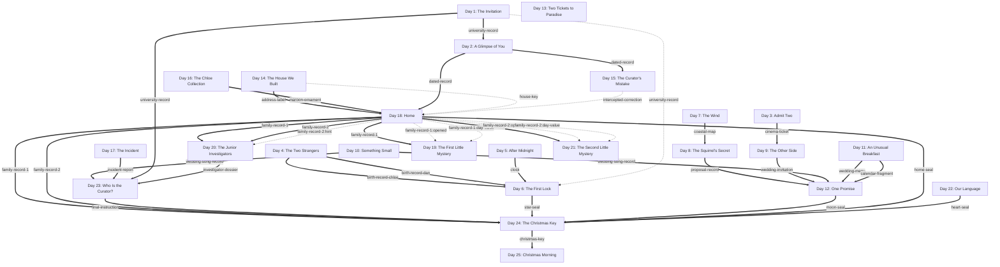

# Puzzle map

Generated from `server/content` by `npm run docs:generate`. Do not edit by hand.

Graph validation: **valid** (no missing references, no cycles, no impossible states).

## Dependency diagram

Thick arrows are mandatory mechanical dependencies (the server refuses attempts without that evidence). Dotted arrows are narrative references or layers revealed later. Every day also requires the previous day (strict sequence), which is not drawn.

## Chapters

| Chapter | Title | Days | Seal |
|---|---|---|---|
| 1 | Where It Began | 1–6 | star |
| 2 | One Promise | 7–12 | moon |
| 3 | Home | 13–18 | home |
| 4 | The Little Mysteries | 19–24 | heart |
| 5 | Christmas Morning | 25–25 | Christmas Key |

## Days

| Day | Title | Interaction | Stages | Requires (mandatory) | Rewards |
|---|---|---|---|---|---|
| 1 | The Invitation | envelope | place (text) | - | Register of Arrivals, entitlement: archive |
| 2 | A Glimpse of You | frost | year (code) | Register of Arrivals | University Record, 2010 |
| 3 | Admit Two | - | pieces (placement), film (text) | - | Cinema Ticket |
| 4 | The Two Strangers | clues | years (dials) | - | Record A, Record B |
| 5 | After Midnight | clock | activity (text) | - | The Night Clock |
| 6 | The First Lock | clues | combination (code) | Record A, Record B, The Night Clock | Star Seal, Folded Note |
| 7 | The Wind | postcard | place (text) | - | Coastal Map |
| 8 | The Squirrel's Secret | woodland | creature (choice) | Coastal Map | Proposal Record, Ring Token |
| 9 | The Other Side | clues | phrase (tiles) | Cinema Ticket | Wedding Invitation, on open: lamp |
| 10 | Something Small | - | title (tiles), artist (choice) | - | Music Box, Wedding Song Record |
| 11 | An Unusual Breakfast | - | dish (choice) | - | Wedding Menu, Calendar Fragment |
| 12 | One Promise | clues | combination (code) | Proposal Record, Wedding Invitation, Wedding Song Record, Wedding Menu, Calendar Fragment | Moon Seal, Wedding Record, Intercepted Message |
| 13 | Two Tickets to Paradise | - | trip (fields) | - | Honeymoon Postcard |
| 14 | The House We Built | house | street (text) | - | House Key, Address Label |
| 15 | The Curator's Mistake | - | correction (compare) | University Record, 2010 | Intercepted Correction |
| 16 | The Chloe Collection | - | sort (sorting) | - | Maroon Ornament |
| 17 | The Incident | clues | conclusion (fields) | - | Incident Report PORCH/001 |
| 18 | Home | - | slots (evidence-slots) | Address Label, Maroon Ornament, University Record, 2010 | Home Seal, The First Little Mystery, The Second Little Mystery |
| 19 | The First Little Mystery | - | birthday (date) | The First Little Mystery | reveals family-record-1:day-value |
| 20 | The Junior Investigators | media | match (placement) | The First Little Mystery, The Second Little Mystery | Investigators' Dossier |
| 21 | The Second Little Mystery | - | birthday (date) | The Second Little Mystery | reveals family-record-2:day-value |
| 22 | Our Language | clues | phrase (tiles) | - | Heart Seal, A Letter |
| 23 | Who Is the Curator? | clues | board (select-many), name (text) | Wedding Song Record, Incident Report PORCH/001, Register of Arrivals, Investigators' Dossier | Final Instruction, The Curator |
| 24 | The Christmas Key | emblem | combination (code), seals (placement) | The First Little Mystery, The Second Little Mystery, Final Instruction, Star Seal, Moon Seal, Home Seal, Heart Seal | The Christmas Key, entitlement: christmas-key |
| 25 | Christmas Morning | vault | unlock (key) | The Christmas Key | - |

## All edges

| From | To | Via | Kind |
|---|---|---|---|
| 1 | 2 | university-record | mandatory |
| 4 | 6 | birth-record-chloe | mandatory |
| 4 | 6 | birth-record-dan | mandatory |
| 5 | 6 | clock | mandatory |
| 1 | 6 | university-record | narrative |
| 7 | 8 | coastal-map | mandatory |
| 3 | 9 | cinema-ticket | mandatory |
| 8 | 12 | proposal-record | mandatory |
| 9 | 12 | wedding-invitation | mandatory |
| 10 | 12 | wedding-song-record | mandatory |
| 11 | 12 | wedding-menu | mandatory |
| 11 | 12 | calendar-fragment | mandatory |
| 2 | 15 | dated-record | mandatory |
| 14 | 18 | address-label | mandatory |
| 16 | 18 | maroon-ornament | mandatory |
| 2 | 18 | dated-record | mandatory |
| 14 | 18 | house-key | narrative |
| 15 | 18 | intercepted-correction | narrative |
| 18 | 19 | family-record-1 | mandatory |
| 18 | 20 | family-record-1 | mandatory |
| 18 | 20 | family-record-2 | mandatory |
| 18 | 21 | family-record-2 | mandatory |
| 10 | 23 | wedding-song-record | mandatory |
| 17 | 23 | incident-report | mandatory |
| 1 | 23 | university-record | mandatory |
| 20 | 23 | investigator-dossier | mandatory |
| 18 | 24 | family-record-1 | mandatory |
| 18 | 24 | family-record-2 | mandatory |
| 23 | 24 | final-instruction | mandatory |
| 6 | 24 | star-seal | mandatory |
| 12 | 24 | moon-seal | mandatory |
| 18 | 24 | home-seal | mandatory |
| 22 | 24 | heart-seal | mandatory |
| 24 | 25 | christmas-key | mandatory |
| 18 | 19 | family-record-1:opened | layer |
| 18 | 19 | family-record-1:day-value | layer |
| 18 | 20 | family-record-2:hint | layer |
| 18 | 21 | family-record-2:opened | layer |
| 18 | 21 | family-record-2:day-value | layer |
